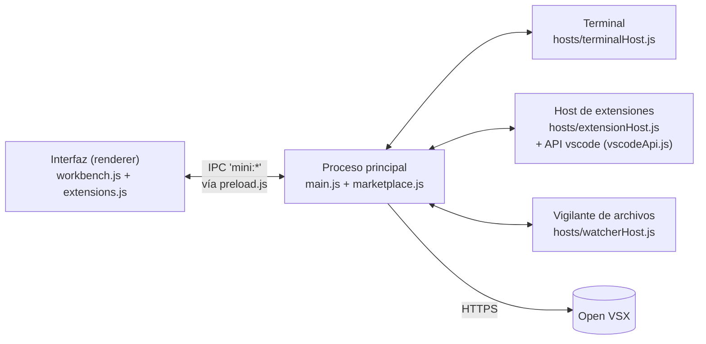

# Mini Code

Un VS Code en miniatura hecho con **Electron + Monaco + xterm.js**. Copia la
arquitectura de procesos del VS Code real, que se estudió con
[REA (Reverse Engineer Anything)](https://github.com/morluto/rea) sobre la
versión 1.140 instalada, y escribe cada pieza desde cero.

Incluye explorador de archivos, pestañas, el editor Monaco (el mismo de VS Code),
búsqueda en archivos, paleta de comandos, terminal, barra de estado y un
**marketplace de extensiones** conectado a [Open VSX](https://open-vsx.org) donde
funcionan extensiones reales de VS Code (comandos y temas de color).

## Requisitos

- **Node.js 20 o superior** (con npm). Compruébalo con `node --version`.
- **Git**, para descargar el proyecto.
- Windows, macOS o Linux. Se ha probado en Windows 11.

## Ponerlo en marcha

1. Descarga el proyecto:
   ```bash
   git clone https://github.com/devch-tech/minicode.git
   cd minicode
   ```
2. Instala las dependencias (Electron, Monaco, xterm y adm-zip; unos 500 MB):
   ```bash
   npm install
   ```
3. Arráncalo:
   ```bash
   npm start
   ```
   O abre directamente una carpeta:
   ```bash
   npx electron . "C:\ruta\a\tu\proyecto"
   ```

La primera vez se abre sin carpeta: pulsa **Abrir carpeta** o `Ctrl+O`.

## Qué puedes hacer

| Función | Cómo |
| --- | --- |
| Abrir una carpeta | `Ctrl+O` |
| Ir a un archivo por nombre | `Ctrl+P` |
| Paleta de comandos | `Ctrl+Shift+P` o `F1` |
| Ir a una línea | `Ctrl+G` |
| Guardar / guardar todo | `Ctrl+S` / `Ctrl+Alt+S` |
| Nuevo archivo | `Ctrl+N` |
| Cerrar pestaña / cambiar de pestaña | `Ctrl+W` / `Ctrl+Tab` |
| Buscar en todos los archivos | `Ctrl+Shift+F` |
| Explorador / extensiones | `Ctrl+Shift+E` / `Ctrl+Shift+X` |
| Mostrar u ocultar la barra lateral | `Ctrl+B` |
| Terminal | `` Ctrl+` `` o `Ctrl+J` |
| Formatear el documento | `Shift+Alt+F` |
| Ajuste de línea | `Alt+Z` |
| Tamaño de letra | `Ctrl+=` / `Ctrl+-` |
| Crear, renombrar o borrar archivos | Clic derecho en el explorador |
| Tema de color | Paleta → `Preferencias: Tema de color` |

## Extensiones y marketplace

El panel de extensiones (`Ctrl+Shift+X`) busca en **Open VSX**, el catálogo
abierto que usan VSCodium, Cursor y Gitpod. El Marketplace de Microsoft solo
puede usarse desde productos de Microsoft, por eso no se usa aquí.

Al pulsar **Instalar**:

1. Se descarga el `.vsix` y se comprueba su huella SHA-256 con la que publica Open VSX.
2. Se extrae en la carpeta de datos de la app (en Windows,
   `%APPDATA%\mini-code\extensions`), sin dejar que escriba fuera de ella.
3. Se reinicia el host de extensiones, como «Recargar ventana» en VS Code.

Cada extensión instalada muestra una etiqueta **Compatible**, **Compatibilidad
parcial** o **No compatible**. Al pasar el ratón ves qué partes funcionan.

**Funciona:** comandos, atajos de teclado, temas de color, valores por defecto
de los ajustes y la parte más usada de la API `vscode` (editor activo,
selecciones, ediciones, mensajes con botones, `showQuickPick`, `showInputBox`,
portapapeles, barra de estado y `executeCommand`). Probado con
`wmaurer.change-case` y `dracula-theme.theme-dracula`.

**No funciona:** lenguajes y resaltado propio, autocompletado y servidores de
lenguaje, fragmentos, depurador, vistas y paneles propios, webviews, editores
personalizados, temas de iconos y Git. Por eso las extensiones de Python, Java
o Go se instalan pero no hacen nada útil.

Las extensiones son código que se ejecuta en tu equipo con tus permisos, igual
que en VS Code: instala solo las que conozcas.

### Escribir tu propia extensión

Crea una carpeta en `extensions/` con dos archivos; al reiniciar aparece en la
paleta. Usan el mismo formato que las de VS Code.

`extensions/mi-extension/package.json`:

```json
{
  "name": "mi-extension",
  "publisher": "yo",
  "displayName": "Mi extensión",
  "version": "1.0.0",
  "engines": { "vscode": "^1.80.0" },
  "main": "extension.js",
  "contributes": {
    "commands": [{ "command": "mi.fecha", "title": "Insertar fecha", "category": "Mi" }],
    "keybindings": [{ "command": "mi.fecha", "key": "ctrl+alt+d" }]
  }
}
```

`extensions/mi-extension/extension.js`:

```js
const vscode = require('vscode');

exports.activate = (context) => {
  context.subscriptions.push(
    vscode.commands.registerCommand('mi.fecha', () => {
      const editor = vscode.window.activeTextEditor;
      if (!editor) return;
      editor.edit((edit) => edit.replace(editor.selection, new Date().toLocaleString()));
    }),
  );
};
```

Hay dos ejemplos completos en [`extensions/hello`](extensions/hello) y
[`extensions/text-tools`](extensions/text-tools).

## Cómo está hecho

Igual que VS Code, la app se reparte en varios procesos. Si una extensión o el
terminal se cuelgan, el editor sigue respondiendo.



| VS Code (archivo en `resources/app/out`) | Mini Code | Qué hace |
| --- | --- | --- |
| `main.js` + `mainImpl.js` | [`main.js`](main.js) | Ventana, diálogos, disco, IPC y arranque de los demás procesos |
| `vs/base/parts/sandbox/electron-browser/preload.js` | [`preload.js`](preload.js) | Puente seguro: VS Code expone `window.vscode` y solo deja canales `vscode:`; aquí `window.mini` y canales `mini:` |
| `vs/workbench/workbench.desktop.main.js` | [`renderer/`](renderer) | Toda la interfaz, sin acceso a Node |
| `vs/editor/...` (Monaco) | `monaco-editor` (npm) | El editor de texto |
| `vs/platform/terminal/node/ptyHostMain.js` | [`hosts/terminalHost.js`](hosts/terminalHost.js) | Terminal en su propio proceso |
| `vs/workbench/api/node/extensionHostProcess.js` | [`hosts/extensionHost.js`](hosts/extensionHost.js) | Carga y activa las extensiones |
| `vs/workbench/api/common/extHost.api.impl` | [`hosts/vscodeApi.js`](hosts/vscodeApi.js) | Lo que recibe una extensión con `require('vscode')` |
| `vs/platform/extensionManagement` | [`marketplace.js`](marketplace.js) | Buscar, descargar, verificar e instalar extensiones |
| `vs/platform/files/node/watcher/watcherMain.js` | [`hosts/watcherHost.js`](hosts/watcherHost.js) | Avisa de cambios en el disco |

Detalles que se copiaron del original:

- **Aislamiento:** la ventana usa `contextIsolation`, `sandbox` y sin
  `nodeIntegration`. La interfaz solo puede pedir cosas al proceso principal,
  y solo por canales que empiezan por `mini:`.
- **Carpeta abierta como límite:** el proceso principal rechaza leer o escribir
  fuera de la carpeta que hayas abierto.
- **Activación perezosa:** una extensión se carga cuando ejecutas uno de sus
  comandos, o al arrancar si declara `*` u `onStartupFinished`.
- **Extensiones sin tocar la interfaz:** cuando una extensión edita texto o
  muestra un mensaje, su proceso envía una petición y la interfaz la aplica.

## Estructura

```
minicode/
├── main.js              proceso principal
├── preload.js           puente seguro entre interfaz y proceso principal
├── marketplace.js       Open VSX: búsqueda, descarga, SHA-256, temas
├── hosts/
│   ├── extensionHost.js host de extensiones
│   ├── vscodeApi.js     API "vscode" para las extensiones
│   ├── terminalHost.js  terminal
│   └── watcherHost.js   vigilante de archivos
├── renderer/
│   ├── index.html
│   ├── workbench.js     explorador, pestañas, editor, búsqueda, paleta, terminal
│   ├── extensions.js    panel de extensiones, temas, peticiones de extensiones
│   └── workbench.css
├── extensions/          extensiones de ejemplo integradas
└── test/
    ├── smoke.js         prueba de la app completa (sin internet)
    └── marketplace.js   prueba del marketplace contra Open VSX (con internet)
```

## Pruebas

Las dos pruebas abren la app de verdad, la manejan sola y guardan capturas y
resultados en `test/out/`. Usan un perfil temporal, así que no tocan tus
extensiones ni tus ajustes.

```bash
npm test                  # 12 comprobaciones: editar, guardar, paleta, búsqueda, terminal…
npm run test:marketplace  # 11 comprobaciones: instala change-case y Dracula y los usa
```

## Problemas conocidos

| Problema | Solución |
| --- | --- |
| Electron se cierra con `Error loading V8 startup snapshot file` | La carpeta del proyecto está en una ruta virtualizada o demasiado larga. Muévela a una ruta corta y normal, por ejemplo `C:\proyectos\minicode`. |
| `git clone` falla con «Filename too long» en otros proyectos | `git config --global core.longpaths true` |
| Aviso en la consola sobre los *workers* de Monaco | Es normal: desde `file://` no se pueden cargar, y Monaco trabaja en el hilo principal. |
| `Ctrl+C` no detiene un comando en el terminal | El terminal usa tuberías, no `node-pty`; no funciona con programas interactivos (vim, ssh…). |

## Diferencias con el VS Code real

- El terminal es sencillo: comandos de una línea, sin programas interactivos.
- La API `vscode` cubre la parte más usada, no toda.
- No hay servidores de lenguaje, depurador, Git ni sincronización de ajustes.
- Lo que guardan las extensiones (`globalState`) se pierde al cerrar la app.

## Créditos

- [Monaco Editor](https://github.com/microsoft/monaco-editor) y la arquitectura
  de [VS Code](https://github.com/microsoft/vscode) (MIT), de Microsoft.
- [xterm.js](https://github.com/xtermjs/xterm.js) para el terminal.
- [Open VSX](https://open-vsx.org) (Eclipse Foundation) como catálogo de extensiones.
- [REA](https://github.com/morluto/rea) para estudiar la app instalada.
